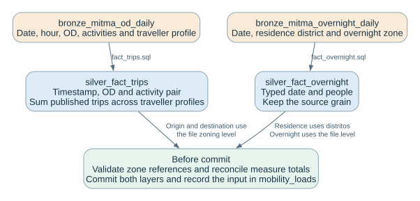
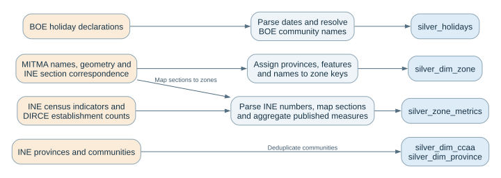

# Bronze to Silver transformations

Silver brings MITMA mobility and geography, INE geography and statistics, and
BOE holidays into one consistent model. Use the first table to locate the SQL
for a specific output. The sections below explain the changes in grain, key
rules, and what the loader checks before committing.

| Silver table | Bronze inputs | Transformation |
|---|---|---|
| [Trips](tables/silver_fact_trips.md) | Daily MITMA trips | [Type and aggregate trips](../sql/bronze_to_silver/fact_trips.sql) |
| [Overnight stays](tables/silver_fact_overnight.md) | Daily MITMA overnight stays | [Type dates and counts](../sql/bronze_to_silver/fact_overnight.sql) |
| [Communities](tables/silver_dim_ccaa.md) and [provinces](tables/silver_dim_province.md) | INE province and community list | [Build administrative dimensions](../sql/bronze_to_silver/dimensions.sql) |
| [Zones](tables/silver_dim_zone.md) | MITMA names, geometries, and INE-to-MITMA correspondence | [Join features, names and provinces](../sql/bronze_to_silver/dimensions.sql) |
| [Holidays](tables/silver_holidays.md) | BOE calendar records | [Parse dates and resolve region codes](../sql/bronze_to_silver/holidays.sql) |
| [Zone metrics](tables/silver_zone_metrics.md) | INE ADRH and DIRCE, MITMA correspondence | [Map sections and parse values](../sql/bronze_to_silver/section_mapping.sql) · [Aggregate statistics by zone](../sql/bronze_to_silver/zone_metrics.sql) |

## Daily MITMA facts

Both SQL files receive their Bronze source table as the `$source_table`
parameter from the batch loader, so one file serves every zoning level and date.

**Trips.** `fecha = '20230306'` and `periodo = '08'` become the timestamp
`2023-03-06 08:00:00`. The query groups by that timestamp, zone level, origin,
destination, and both activities, then sums `viajes` as a `DOUBLE`. Distance,
study flags, residence, income band, age, sex, and `viajes_km` stay available in
Bronze. Published trip volumes contribute even if age or sex is suppressed.
An OD-hour missing from the source stays absent. [Trip SQL](../sql/bronze_to_silver/fact_trips.sql)

**Overnight stays.** The query casts `fecha` to `DATE` and `personas` to
`DOUBLE`. One source observation stays one Silver row. `zona_residencia`
becomes `residence_district_id`, which joins to the district zone dimension.
`zona_pernoctacion` becomes `overnight_zone_id`, which joins at the file's zone
level. [Overnight SQL](../sql/bronze_to_silver/fact_overnight.sql)

For each expected file, Python stages the input and checks the column set.
Bronze queries check the file date, duplicate source keys, numerical measures,
and zone references. Trips can produce fewer Silver rows after aggregation.
Overnight stays must keep the same row count. Both must conserve the published
total within floating-point tolerance. The loader commits Bronze, Silver and
`mobility_loads` in the same transaction. An invalid batch leaves no committed
load record. [Batch loader](../scripts/lakehouse/mobility.py) · [Trip checks](../sql/validation/bronze_trips.sql) · [Overnight checks](../sql/validation/bronze_overnight.sql)

## Geography and holidays

- **Communities and provinces.** The INE list provides `CODAUTO` and `CPRO`.
  The community dimension keeps each community once, and the province
  dimension retains its community code. Codes stay as text to keep leading
  zeros. [Dimension SQL](../sql/bronze_to_silver/dimensions.sql)
- **Zones.** Polygons and centroids are paired by `(zone_level, zone_id)`.
  Names come from the MITMA names file, falling back to the ID where needed.
  The first two digits of the INE municipality code supply the province for
  zones with a mapped section. Bronze checks province consistency before the
  SQL selects a province per zone. French and Portuguese zones and `externo`
  are marked as foreign. The added `externo` row at each level has no geometry.
  Geometries retain their EPSG:3042 coordinates. [Dimension SQL](../sql/bronze_to_silver/dimensions.sql) · [Reference checks](../sql/validation/reference_bronze.sql)
- **Holidays.** Python first reshapes the BOE XML grid for Bronze. Silver keeps
  cells with a holiday mark, combines the year, Spanish month and leading day
  number into a date, then removes footnote markers from the BOE region label
  to look up its INE community code. The result is one date and region per row.
  [XML parser](../scripts/lakehouse/reference.py) · [Holiday SQL](../sql/bronze_to_silver/holidays.sql)

## Population, income and businesses by zone

### Parse and align census sections

1. Keep the 2023 section-level rows for the eight ADRH indicators used by the
   project. Keep population, net income, wages, pensions, unemployment income,
   Gini, mean age and population aged 65 or over. The section ID is the first
   ten characters of the INE field.
2. Parse Spanish-formatted numbers. `2.908` becomes `2908`, and `40,8`
   becomes `40.8`. Empty strings, `.` and `..` become `NULL`. An unexpected
   numeric format fails the load.
3. For sections with a published population, match the exact correspondence
   first. Otherwise use the most common MITMA district for the same INE
   district, then for the same INE municipality. Count ties resolve by MITMA
   district ID. The explicit final fallback maps Usansolo (`48916`) to the
   Galdakao district (`48036`). Derive municipality and GAU from the matched
   MITMA district. This stages one section match at each level.

`ine_section_indicators`, `ine_section_values` and `section_zones` are temporary
intermediates. The persistent result stores one row per zone with population
metrics. [Section matching and number parsing](../sql/bronze_to_silver/section_mapping.sql)

### Aggregate each source at its own grain

**ADRH.** Sum population within each zone. For rates and averages, weight by
the populations of sections that published the indicator. The denominator
excludes sections with a missing value. The Gini result is a weighted summary
of section Gini values. Compare population totals separately by zone level.

**DIRCE.** Start from 2023 municipal rows and keep the total plus four broad
activities. Map each municipality to one MITMA municipal zone and its GAU.
Keep Los Montesinos in its own MITMA municipal zone to avoid counting it
twice. District business measures stay `NULL` because the source is municipal.
Join the business aggregates to the population metrics by level and zone ID.
[Zone metrics SQL](../sql/bronze_to_silver/zone_metrics.sql)

### Validate before publishing the reference snapshot

The reference checks cover duplicate keys, valid administrative and zone
references, required indicators and activities, and exactly one mapped zone
per populated section at each level. They also reconcile population and
business totals. The verified 2023 snapshot preserves 47,972,964 people at
each level and 3,205,679 published businesses at both municipality and GAU
levels. The loader commits the reference inputs, the Silver tables and the
completion record together. [Bronze checks](../sql/validation/reference_bronze.sql) · [Silver checks](../sql/validation/reference_silver.sql) · [Verified counts](progress.md#sprint-2--ducklake-implementation-and-ingestion)

[Lakehouse map](lakehouse.md) · [Table catalog](tables/README.md) · [Silver DDL](../sql/schema/silver.sql)
