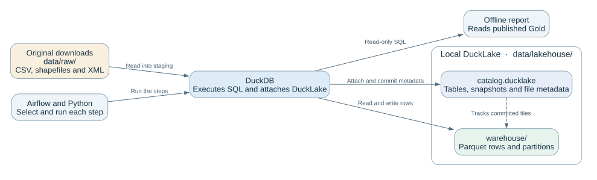
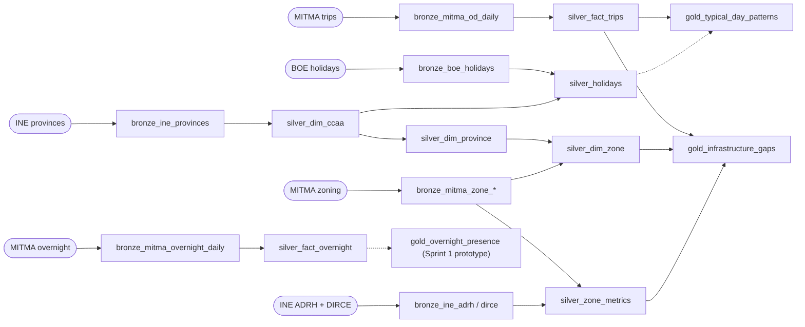
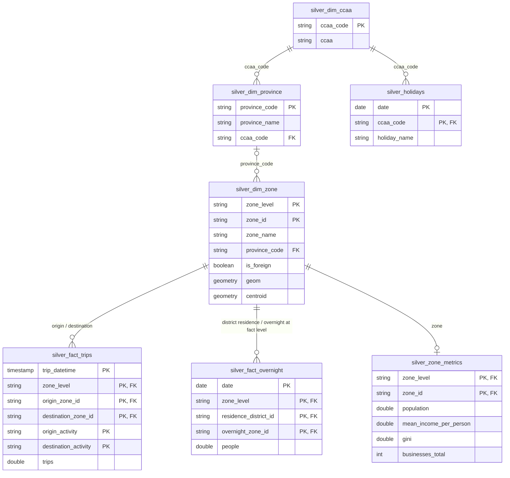
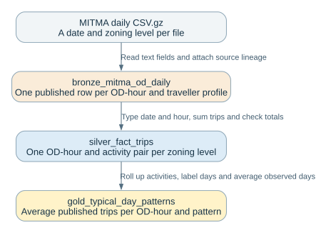

# Lakehouse map

This is the architecture overview for the Spanish mobility lakehouse. Follow
one file through the layers, then use the [table catalog](tables/README.md) to
look up any dataset. The implemented analytical window is 6–12 March 2023.

## Where the data lives



| Location | What it contains |
|---|---|
| `data/raw/` | Original MITMA, INE and BOE downloads used to reproduce Bronze. |
| `data/lakehouse/catalog.ducklake` | DuckLake metadata in a DuckDB file. It records table definitions, snapshots, and which Parquet files belong to each committed snapshot. |
| `data/lakehouse/warehouse/` | Parquet files for the persisted Bronze, Silver, Gold and load tracking tables. |
| `data/reports/sprint3/` | The HTML, charts and maps produced by querying Gold. |

DuckDB executes SQL. Once it attaches the catalog as `lake`, a name such as
`lake.main.silver_fact_trips` resolves to the committed files registered for
that table. Airflow orders the Python commands. Python stages inputs, invokes
the SQL, handles validation failures and commits the changes.

Partitioning follows the filters used in the pipeline. The Bronze mobility
tables split by zone level and source date. Silver trips split by zone level
and calendar year, month and day. Silver overnight stays split by zone level
and date. Gold OD averages split by reporting window, level and pattern basis.
The gravity pair table splits by reporting window. [Bronze and Silver partition definitions](../sql/schema/ducklake.sql) · [Gold table definitions](../sql/schema/gold.sql)

The sample uses 2.72 GB of daily source archives and 5.61 GB of Parquet
including reference data and Gold. Bronze and Silver load by day and zoning
level, so a longer load can resume after a failed file. Gold is verified for one
week. Its gravity candidate count grows with the product of eligible origins
and destinations, while its OD tables store each window and pattern basis.

## Schema overview

Each source lands in one Bronze table, is cleaned and typed into Silver, and is
aggregated into Gold. For a visual map of every table grouped by layer, open the
[all-tables overview (draw.io)](diagrams/schemas/tables_overview.drawio). [Source inventory](data_sources.md) · [Bronze to Silver rules](bronze-to-silver.md) · [Editable diagrams](diagrams/README.md)



Silver is a star schema. Facts point to `silver_dim_zone` by the pair
(`zone_level`, zone id); zones point to provinces and provinces to communities.
DuckLake does not enforce keys, so the PK/FK below are design keys checked with
validation queries. Per-column detail lives in each [table card](tables/README.md).



The `silver_zone_metrics` box shows only key columns; its card lists the full
income, demographic and business set.

## Follow a daily trips file



1. **Bronze records the source.** A municipal trips file for 6 March 2023
   contributed 11,254,679 rows to `bronze_mitma_od_daily`. The loader attaches
   the source path and ingestion time. [Bronze trips](tables/bronze_mitma_od_daily.md)
2. **Silver gives trips a consistent grain.** `fact_trips.sql` turns the date
   and hour into a timestamp and sums across traveller profiles within each
   origin, destination and activity pair. The same file produced 4,683,041
   Silver rows. Both layers represent about 135,595,000 published trips for
   that batch. [Silver trips](tables/silver_fact_trips.md) · [Bronze to Silver rules](bronze-to-silver.md#daily-mitma-facts)
3. **Gold answers a question over the week.** For the typical day, the SQL
   rolls up activity combinations and averages published daily OD-hour totals
   by calendar type or cluster. `observed_days` tells you how many daily totals
   contributed to a row. The gravity analysis combines Silver trips with
   population, business counts and centroid distances. [Typical-day table](tables/gold_typical_day_patterns.md) · [Gravity table](tables/gold_infrastructure_gaps.md)

Keep zone level in joins on zone IDs. The same ID can appear at multiple
levels. Overnight residence is always linked at district level, even for a
municipal or GAU overnight destination. [Silver fact relationships](bronze-to-silver.md#daily-mitma-facts)

## What becomes visible after a load

| Load | What commits together | How a retry finds existing work |
|---|---|---|
| Reference snapshot | The seven Bronze reference tables, five Silver reference tables, and the 2023 completion record. | `reference_load` tracks the catalog's reference year. |
| Daily mobility file | The staged Bronze rows, the validated Silver fact rows, and one load record. | `mobility_loads` identifies the dataset, zoning level and observation date. |
| Gold week | Seven validated analytical tables for the window and the Gold completion record. | `gold_runs` identifies the window and model revision. Existing results pass the Gold checks again before reuse. |

The report reads a single validated DuckLake snapshot and publishes HTML and figures.
Reusable code paths are linked from the [transformation guide](bronze-to-silver.md)
and the [Gold analysis guide](sprint3.md).

## Design decisions

The choices that shape the model. Larger ones have an [ADR](decisions/).

1. **One table per source with a `zone_level` column**, not one table per level: fewer tables, and one query serves all three levels by changing a filter.
2. **Column names in English and real types from Silver on.** Bronze keeps the source names and values as text (e.g. MITMA `fecha` as `20230306`); Silver uses `snake_case` and proper types (e.g. `trip_datetime` of type `TIMESTAMP`).
3. **Star schema in Silver**: facts keyed by zone, joined to small dimensions. No date dimension, because every calendar attribute derives from the date and `silver_holidays`.
4. **Foreign zones** (French and Portuguese NUTS-3, `externo`) are kept in Silver flagged with `is_foreign`, so an analysis can exclude them.
5. **Reference year 2023**: INE tables are filtered to `Periodo = 2023` entering Silver. Bronze keeps all years, so others can be added later.
6. **INE reaches MITMA through census sections**, not municipality codes: a direct code join loses about 11% of the population, and only sections map to all three levels. [Mapping rules](bronze-to-silver.md#population-income-and-businesses-by-zone)
7. **BQ2 at municipality level**, because business counts (`E_j`) are only published per municipality; GAU is added by aggregation.
8. **Distances are computed in Gold**: BQ2 uses great-circle distances between centroids and excludes same-zone pairs.
9. **Design keys checked with queries**: DuckLake does not enforce PK/FK, so duplicate and orphan checks run before each commit.
10. **Daily partitions committed per (`dataset`, `zone_level`, `observation_date`)** with a load record, so retries skip completed work. [ADR 002](decisions/002-local-ducklake-batches.md)
11. **Categorical and code columns stay `VARCHAR`**: DuckLake rejects `ENUM` and ignores `VARCHAR(n)` length, Parquet already dictionary-encodes low-cardinality strings, and codes keep leading zeros. [ADR 004](decisions/004-silver-column-types.md)

## Inspect the lakehouse

Attach the catalog read-only as shown in the [runbook](runbook.md#query-the-local-lakehouse).
This query checks which original file produced the sample partition, its row
counts on both sides, and the volume published by MITMA.

```sql
SELECT source_file, bronze_rows, silver_rows, published_total
FROM lake.main.mobility_loads
WHERE dataset = 'viajes'
  AND zone_level = 'municipios'
  AND observation_date = DATE '2023-03-06';
```

To see how table rows map to files, inspect DuckLake's file metadata for a
partitioned fact.

```sql
SELECT data_file
FROM ducklake_list_files('lake', 'silver_fact_trips')
LIMIT 5;
```

[Table catalog](tables/README.md) · [Bronze to Silver guide](bronze-to-silver.md) · [Diagram sources](diagrams/README.md) · [Verification results](progress.md)
