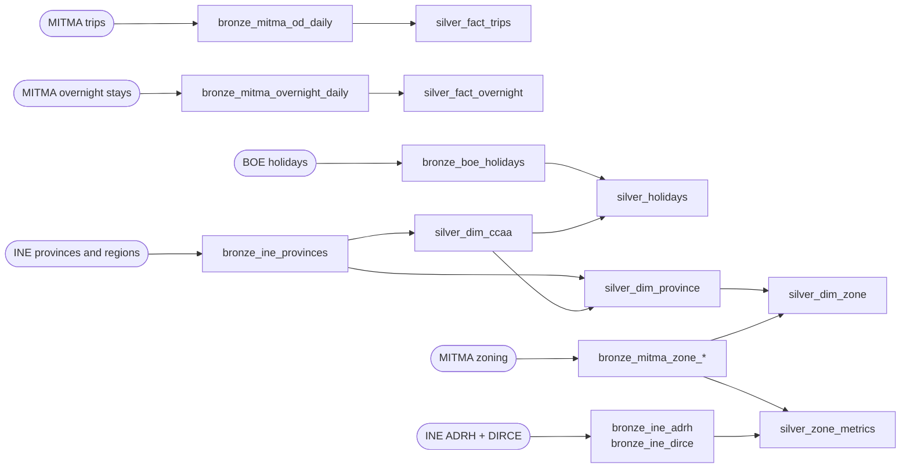
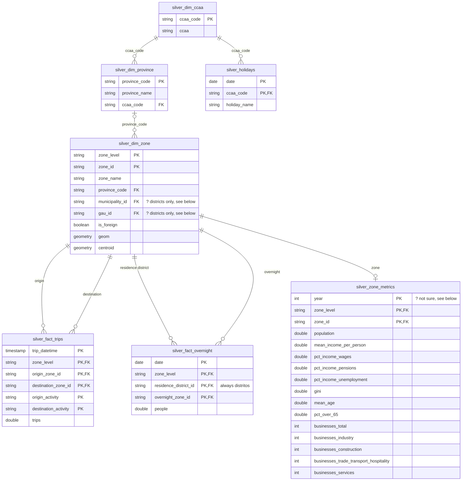

# Lakehouse Schema

Schemas of the two first tiers of the lakehouse: **Bronze** (raw) and **Silver** (clean star schema).
Storage target is DuckLake (Sprint 2); in Sprint 1 the same tables are prototyped in plain DuckDB in `notebooks/02_exploration_bronze_silver.ipynb`, which also shows how each decision below was reached.

Business questions: **BQ1** typical day, **BQ2** gravity model and infrastructure gaps, **BQ3** overnight stays.

### Sources → Bronze → Silver

---

## Bronze – raw data as-is

Rules for every Bronze table:
- Column names and values exactly as in the source file, all as `VARCHAR` (no casting, no cleaning).
- `zone_level` (`distritos`, `municipios`, `GAU`) is added when the level is only known from the folder name, so the three levels share one table.
- Two lineage columns are added at the end: `_source_file VARCHAR` (path of the source file) and `_ingested_at TIMESTAMP WITH TIME ZONE`. They are not repeated in the tables below.

### Tables (Bronze)

Bronze has **no keys and no relations**: each table is loaded on its own, as the source gives it. It may contain duplicates, `NA` codes and zones that do not exist in the zoning. Relations start in Silver. In the diagram, each box marked `dataset` is a source, and its arrow points to the table it loads.

```mermaid
classDiagram
    direction LR
    class MITMA_trips {
        <<dataset>>
        Daily origin-destination trips
        per hour, at the 3 zone levels
    }
    class bronze_mitma_od_daily {
        VARCHAR fecha
        VARCHAR periodo
        VARCHAR origen
        VARCHAR destino
        VARCHAR distancia
        VARCHAR actividad_origen
        VARCHAR actividad_destino
        VARCHAR estudio_origen_posible
        VARCHAR estudio_destino_posible
        VARCHAR residencia
        VARCHAR renta
        VARCHAR edad
        VARCHAR sexo
        VARCHAR viajes
        VARCHAR viajes_km
        VARCHAR zone_level
    }
    MITMA_trips --> bronze_mitma_od_daily

    class MITMA_overnight_stays {
        <<dataset>>
        Where people sleep and where they live
        per day, at the 3 zone levels
    }
    class bronze_mitma_overnight_daily {
        VARCHAR fecha
        VARCHAR zona_residencia
        VARCHAR zona_pernoctacion
        VARCHAR personas
        VARCHAR zone_level
    }
    MITMA_overnight_stays --> bronze_mitma_overnight_daily

    class MITMA_zone_names {
        <<dataset>>
        Name of each zone
        at the 3 zone levels
    }
    class bronze_mitma_zone_names {
        VARCHAR ID
        VARCHAR name
        VARCHAR zone_level
    }
    MITMA_zone_names --> bronze_mitma_zone_names

    class MITMA_shapefiles {
        <<dataset>>
        Polygons and centroids of each zone
        at the 3 zone levels
    }
    class bronze_mitma_zone_geometries {
        VARCHAR ID
        GEOMETRY geom
        VARCHAR geometry_type
        VARCHAR zone_level
    }
    MITMA_shapefiles --> bronze_mitma_zone_geometries

    class MITMA_INE_relation {
        <<dataset>>
        Links each INE census section
        to its MITMA zones
    }
    class bronze_mitma_zone_mapping {
        VARCHAR seccion_ine
        VARCHAR distrito_ine
        VARCHAR municipio_ine
        VARCHAR distrito_mitma
        VARCHAR municipio_mitma
        VARCHAR gau_mitma
    }
    MITMA_INE_relation --> bronze_mitma_zone_mapping

    class INE_ADRH {
        <<dataset>>
        Population, income, income sources and Gini
        by census section, tables 30832 30824 30825 37677
    }
    class bronze_ine_adrh {
        VARCHAR Municipios
        VARCHAR Distritos
        VARCHAR Secciones
        VARCHAR indicador
        VARCHAR Periodo
        VARCHAR Total
        VARCHAR table_id
    }
    INE_ADRH --> bronze_ine_adrh

    class INE_DIRCE {
        <<dataset>>
        Businesses by municipality
        and activity group, table 4721
    }
    class bronze_ine_dirce {
        VARCHAR Totales_Territoriales
        VARCHAR Provincias
        VARCHAR Municipios
        VARCHAR Grupos_CNAE
        VARCHAR Periodo
        VARCHAR Total
    }
    INE_DIRCE --> bronze_ine_dirce

    class INE_provinces {
        <<dataset>>
        Region of each province
        list from the INE website
    }
    class bronze_ine_provinces {
        VARCHAR CODAUTO
        VARCHAR Comunidad_Autonoma
        VARCHAR CPRO
        VARCHAR Provincia
    }
    INE_provinces --> bronze_ine_provinces

    class BOE_holidays {
        <<dataset>>
        Public holidays by region
        one file per year
    }
    class bronze_boe_holidays {
        VARCHAR year
        VARCHAR mes
        VARCHAR fiesta
        VARCHAR ccaa
        VARCHAR marca
    }
    BOE_holidays --> bronze_boe_holidays
```

### `bronze_mitma_od_daily`
MITMA trips, one row per day × hour × origin × destination × traveller profile. ~18M rows/day at district level. **Partitioned by `zone_level`, `fecha`.**

| Column | Example | Notes |
|---|---|---|
| `fecha` | `20230306` | Day as `YYYYMMDD` text |
| `periodo` | `19` | Hour `00`–`23` |
| `origen`, `destino` | `01009_AM`, `FR101`, `externo` | Zone code of the level; also French/Portuguese NUTS-3 and `externo` |
| `distancia` | `0.5-2` | Band in km: `0.5-2`, `2-10`, `10-50`, `>50` |
| `actividad_origen`, `actividad_destino` | `casa` | `casa`, `trabajo_estudio`, `frecuente`, `no_frecuente` |
| `estudio_origen_posible`, `estudio_destino_posible` | `no` | `si` / `no` |
| `residencia` | `01` | Province of residence (2 digits) |
| `renta` | `10-15` | Income band, thousand €: `<10`, `10-15`, `>15` |
| `edad` | `25-45` | `0-25`, `25-45`, `45-65`, `65-100`, `NA` |
| `sexo` | `mujer` | `hombre`, `mujer`, `NA` |
| `viajes` | `6.186` | Number of trips (expanded, decimal) |
| `viajes_km` | `5.89` | Total km of the row (trips × km) |
| `zone_level` | `distritos` | Added |

### `bronze_mitma_overnight_daily`
Where residents of a district spend the night. **Partitioned by `zone_level`, `fecha`.**

| Column | Example | Notes |
|---|---|---|
| `fecha` | `20230306` | |
| `zona_residencia` | `01001` | District where people live (always a district in the three files, although the MITMA dictionary says it follows the level of the file) |
| `zona_pernoctacion` | `01051` | Zone where they slept, at the level of the file |
| `personas` | `2715.896` | Number of people |
| `zone_level` | `municipios` | Added |

### `bronze_mitma_zone_names`
One row per zone and level (3,792 districts, 2,618 municipalities, 2,086 GAU). The unnamed index column of `nombres_municipios.csv` is dropped.

| Column | Example |
|---|---|
| `ID` | `01004_AM`, `GAU A Coruña` |
| `name` | `Artziniega agregacion de municipios` |
| `zone_level` | Added |

### `bronze_mitma_zone_geometries`
CRS EPSG:3042 (metres). Includes 117 French and Portuguese zones that are not in the names files. The reader's `OGC_FID` row number is dropped.

| Column | Example | Notes |
|---|---|---|
| `ID` | `01001` | |
| `geom` | `POINT (539945.69 4741948.88)` | `GEOMETRY` (the only non-text column) |
| `geometry_type` | `centroid` | Added: `polygon` / `centroid` |
| `zone_level` | | Added |

### `bronze_mitma_zone_mapping`
One row per INE census section (36,382 rows, 49 of them with `NA` for the unpopulated lands).

| Column | Example |
|---|---|
| `seccion_ine` | `0100101001` |
| `distrito_ine` | `0100101` |
| `municipio_ine` | `01001` |
| `distrito_mitma` | `01001` |
| `municipio_mitma` | `01001` |
| `gau_mitma` | `01001`, `GAU Ávila` |

### `bronze_ine_adrh`
The 4 tables go in one. They share the layout; only the header of the indicator column changes, so it is renamed to `indicador`. All years 2015–2024.

| Column | Example | Notes |
|---|---|---|
| `Municipios` | `01001 Alegría-Dulantzi` | Code + name in one field |
| `Distritos` | `0100101 Alegría-Dulantzi distrito 01` | Empty on municipality rows |
| `Secciones` | `0100101001 ...` | Empty on municipality and district rows |
| `indicador` | `Renta neta media por persona` | 20 indicators |
| `Periodo` | `2023` | |
| `Total` | `16.429`, `40,8` | Spanish number format; empty or `.` = no data |
| `table_id` | `30824` | Added, from the file name |

### `bronze_ine_dirce`
Businesses by municipality and activity group, 2012–2025.

| Column | Example | Notes |
|---|---|---|
| `Totales Territoriales` | `Total Nacional` | |
| `Provincias` | `01 Araba/Álava` | Empty on the national total |
| `Municipios` | `01001 Alegría-Dulantzi` | Empty on national/province totals |
| `Grupos CNAE` | `Industria` | 11 groups incl. `Total` |
| `Periodo` | `2023` | |
| `Total` | `3.207.580` | Spanish number format; empty or `.` = no data |

### `bronze_ine_provinces`
Province and region lists (52 rows), saved from the INE website as `ine/ccaa_provincias.csv`.

| Column | Example |
|---|---|
| `CODAUTO` | `01` |
| `Comunidad Autónoma` | `Andalucía`, `Madrid, Comunidad de` |
| `CPRO` | `04` |
| `Provincia` | `Almería` |

### `bronze_boe_holidays`
The BOE file of each year is an XML table (one row per holiday, one column per region), so it is unpivoted to one row per holiday × region; this is the only reshaping done in Bronze.

| Column | Example | Notes |
|---|---|---|
| `year` | `2023` | Added, from the file name. The table only gives the day and the month |
| `mes` | `ENERO` | From the month separator rows |
| `fiesta` | `6 Epifanía del Señor.` | Day + name |
| `ccaa` | `Cataluña (2)` | Region, with footnote marks |
| `marca` | `**` | `*` / `**` / `***` or empty (not a holiday there) |

---

## Silver – clean, typed star schema (Kimball)

Rules for every Silver table:
- English `snake_case` names and real types (`TIMESTAMP`, `DATE`, `DOUBLE`, `BOOLEAN`).
- Text placeholders become `NULL`: empty and `.` in INE.
- INE data filtered to **2023**.
- Zones are always identified by **(`zone_level`, `zone_id`)**.

### Relational schema (Silver)

Star schema: the fact tables point to the zone dimension, zones point to provinces, and provinces point to regions. Every foreign key to `silver_dim_zone` is a pair: (`zone_level`, zone id). In the overnight residence the level is fixed: it is always `distritos`. DuckLake does not enforce primary or foreign keys, so they are design keys, checked with validation queries (no orphans, no duplicates) instead of constraints.

The primary key of `silver_fact_trips` is every column except `trips`. The other columns of the source are not kept, so the rows that only differ in them are summed. The distance between zones can be calculated when needed from the centroids of `silver_dim_zone`.

### Dimensions

#### `silver_dim_ccaa`
One row per region (19). **PK:** `ccaa_code`.

| Column | Type | Rule |
|---|---|---|
| `ccaa_code` | VARCHAR | `CODAUTO` |
| `ccaa` | VARCHAR | `Comunidad Autónoma` |

#### `silver_dim_province`
One row per province (52). It links zones with regions, and so with the regional holidays. **PK:** `province_code`.

| Column | Type | Rule |
|---|---|---|
| `province_code` | VARCHAR | `CPRO` |
| `province_name` | VARCHAR | `Provincia` |
| `ccaa_code` | VARCHAR | `CODAUTO`. FK to `silver_dim_ccaa` |

#### `silver_dim_zone`
One row per zone and level, including foreign zones (from the geometries) and `externo` (added by hand, no geometry). **PK:** (`zone_level`, `zone_id`).

| Column | Type | From / rule |
|---|---|---|
| `zone_level` | VARCHAR | `distritos`, `municipios`, `GAU` |
| `zone_id` | VARCHAR | `ID` |
| `zone_name` | VARCHAR | `name`; for foreign zones the code itself |
| `province_code` | VARCHAR | First 2 digits of `municipio_ine` in `bronze_mitma_zone_mapping` (not from the ID: the 49 lands start with `34` but are not in Palencia, and GAU IDs are names). Each zone is in one province. `NULL` for foreign zones and those 49 lands |
| `municipality_id` **?** | VARCHAR | `municipio_mitma` of the district in `bronze_mitma_zone_mapping`. `NULL` in other levels and in zones without a district. **Not sure yet**, see the note below |
| `gau_id` **?** | VARCHAR | `gau_mitma` of the district. Same rules as `municipality_id`. **Not sure yet**, see the note below |
| `is_foreign` | BOOLEAN | `true` for `FR*`, `PT*`, `externo` |
| `geom` | GEOMETRY | Polygon (EPSG:3042) |
| `centroid` | GEOMETRY | Centroid (EPSG:3042) |

**`municipality_id` and `gau_id` (?):** the residence in `silver_fact_overnight` is always a district, also in the municipality and GAU rows. To add up the people living in a municipality or GAU, we need to know which districts form it, and no Silver table says so. These columns are only needed if the floating population (BQ3) is calculated at those levels. At district level they are not needed.

#### `silver_holidays`
One row per holiday and region. **PK:** (`date`, `ccaa_code`). **FK:** `ccaa_code` → `silver_dim_ccaa`.

| Column | Type | Rule |
|---|---|---|
| `date` | DATE | Day from `fiesta` + month from `mes` + `year` |
| `ccaa_code` | VARCHAR | INE code (`CODAUTO`), from a list written by hand of the 19 BOE names, because the BOE has no code and writes some names differently from INE |
| `holiday_name` | VARCHAR | `fiesta` without the day number |

National holidays are the days in all 19 regions (`GROUP BY date HAVING COUNT(DISTINCT ccaa_code) = 19`). Rows with an empty `marca` are dropped. Local holidays that only appear in the BOE notes (Canary Islands, Arán, Ceuta) are not included.

### Facts

#### `silver_fact_trips`
Grain: hour × origin × destination × activities, per level. **PK:** (`trip_datetime`, `zone_level`, `origin_zone_id`, `destination_zone_id`, `origin_activity`, `destination_activity`). **Partitioned by `zone_level` and the day of `trip_datetime`.** FK: (`zone_level`, `origin_zone_id` / `destination_zone_id`) → `silver_dim_zone`. Foreign and same-zone trips are kept; an analysis can exclude them when needed.

| Column | Type | Rule |
|---|---|---|
| `trip_datetime` | TIMESTAMP | `strptime(fecha \|\| periodo, '%Y%m%d%H')` |
| `zone_level` | VARCHAR | |
| `origin_zone_id`, `destination_zone_id` | VARCHAR | `origen`, `destino` |
| `origin_activity`, `destination_activity` | VARCHAR | `actividad_*` |
| `trips` | DOUBLE | Sum of `viajes` |

#### `silver_fact_overnight`
Grain: day × residence district × overnight zone, per level of the overnight zone. **Partitioned by `zone_level`, `date`.** FK: (`distritos`, `residence_district_id`) and (`zone_level`, `overnight_zone_id`) → `silver_dim_zone`.

| Column | Type | Rule |
|---|---|---|
| `date` | DATE | |
| `zone_level` | VARCHAR | |
| `residence_district_id` | VARCHAR | `zona_residencia` |
| `overnight_zone_id` | VARCHAR | `zona_pernoctacion` |
| `people` | DOUBLE | `personas` |

#### `silver_zone_metrics`
Population, income and economic activity per zone. Now only for 2023, the reference year. INE values are taken **per census section** and aggregated to each MITMA level, using `bronze_mitma_zone_mapping`. The weighted means ignore sections with no value, in the numerator and in the denominator. The 49 unpopulated lands have no row. **PK:** (`zone_level`, `zone_id`), plus `year` **?**.

| Column | Type | Rule |
|---|---|---|
| `year` **?** | INTEGER | `Periodo`. **Not sure yet**, see the note below |
| `zone_level`, `zone_id` | VARCHAR | |
| `population` | DOUBLE | Sum of `Población` (30832) of the sections → `P_i` |
| `mean_income_per_person` | DOUBLE | `Renta neta media por persona` (30824), mean weighted by section population (0.08% average error against the official municipal figure) |
| `pct_income_wages`, `pct_income_pensions`, `pct_income_unemployment` | DOUBLE | Income sources (30825), weighted mean |
| `gini` | DOUBLE | `Índice de Gini` (37677), weighted mean (approximation) |
| `mean_age`, `pct_over_65` | DOUBLE | 30832, weighted mean |
| `businesses_total` | INTEGER | DIRCE `Total` → `E_j` (99.9% of the national total) |
| `businesses_industry`, `businesses_construction`, `businesses_trade_transport_hospitality`, `businesses_services` | INTEGER | DIRCE groups. Empty means not published, so `NULL`, not 0 |

DIRCE is only published per municipality, so business columns are filled for `municipios` and `GAU` (sum of their municipalities) and are `NULL` for `distritos`. Los Montesinos (03903), which the mapping file sends to two MITMA municipalities, is kept in its own zone `03903`. The detailed groups (J, K, L, MN and others) are not kept because about half of the zones have no value.

**`year` (?):** the table would need this column to work with other years, but it is not decided. The notebook only builds 2023. INE sections change every year and there is only one mapping file, so the rules below would have to be repeated and checked for each year, and we don't know yet how many sections would be left without an exact match.

**How INE sections reach MITMA zones.** The mapping file is older than the 2023 sections, so for each section with people in 2023 (36,477) the MITMA district is searched in this order. The municipality and GAU come from the district. This is a step when building the table; it is not stored in Silver.

| `match_type` | Rule | Sections | People |
|---|---|---|---|
| `exact` | The section is in the mapping file | 36,075 | 47,313,730 (98.6%) |
| `by_district` | Most common MITMA district of its INE district | 398 | 653,273 |
| `manual` | Usansolo (48916), not in the file, goes to Galdakao (48036) | 3 | 4,556 |
| `by_municipality` | Most common MITMA district of its INE municipality | 1 | 1,405 |

The total is exactly the INE population of Spain in 2023: 47,972,964.

---

## Design decisions

1. **One table per source with a `zone_level` column** instead of one table per level: fewer tables, and the same query works for all three levels by changing a filter.
2. **Foreign zones** (French and Portuguese NUTS-3 regions, `externo`) are kept in Silver flagged with `is_foreign`, so that an analysis can exclude them.
3. **Star schema in Silver**: facts keyed by zone, joined to small dimensions. There is no date dimension because all its columns can be calculated from the date and `silver_holidays`.
4. **BQ2 at municipality level**, because business counts (`E_j`) are only published per municipality; GAU as an extra by aggregation.
5. **Column names in English from Silver on**: Bronze keeps the source names (e.g. MITMA's `fecha`, stored as text `20230306`); Silver uses English names and proper types (e.g. `trip_datetime` of type `TIMESTAMP`).
6. **Reference year 2023**: INE tables are filtered to `Periodo = 2023` when moving to Silver. Bronze keeps all years, so other years could be added later (see `silver_zone_metrics`).
7. **INE joins MITMA through census sections**, not municipality codes: a direct code join loses 11% of the population, and only sections reach the three levels.
8. **`P_i` is the INE population**, as the project asks.
9. **Keys are checked with queries**: DuckLake does not enforce keys, so duplicates and orphans are checked after each load.
10. **Distances are not stored in Silver**: they are calculated when needed from the centroids, only BQ2 uses them, and calculating all municipality pairs takes less than a second. Great-circle distance, the same type MITMA uses for its bands; pairs of a zone with itself are left out (distance 0), and pairs with no trips are included.
11. **No table for the section to zone mapping**: it is only a step to build `silver_zone_metrics`, and no query needs it afterwards.
